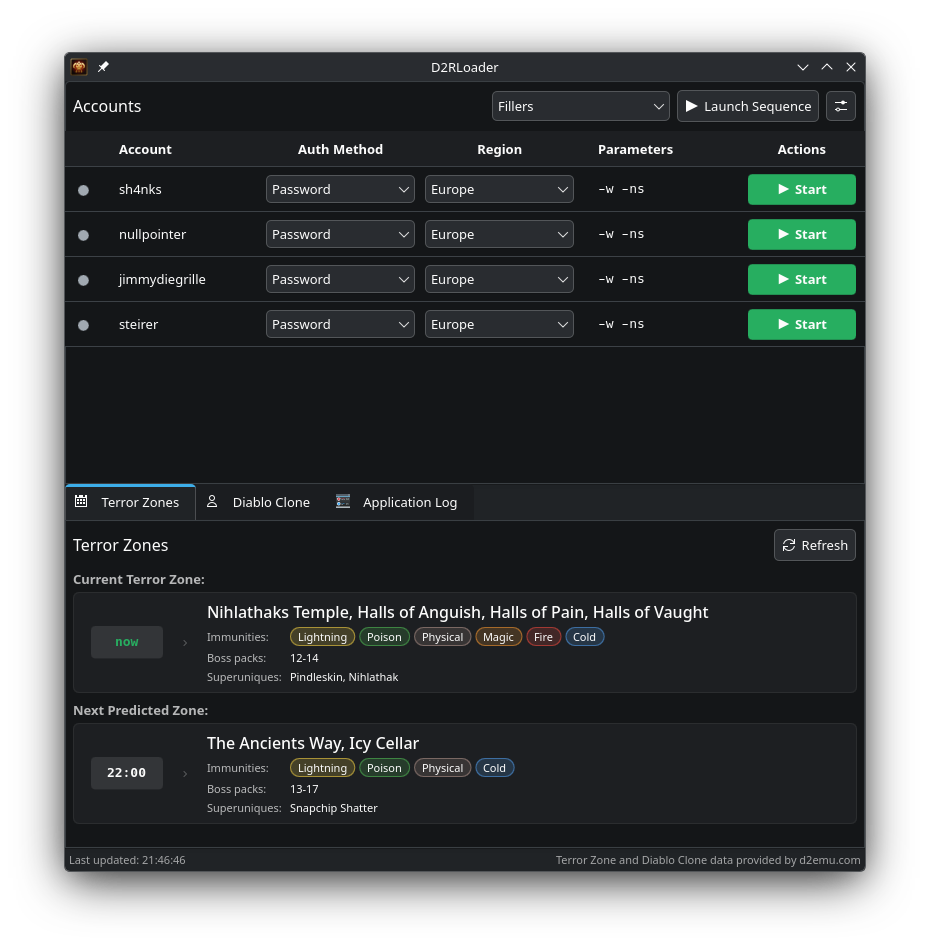

# D2RLoader 2

Note: I'll probably merge this repo into [sh4nks/d2rloader](https://github.com/sh4nks/d2rloader) once
the upgrade path is implemented.

<p align="center">
  
</p>

## Getting Started

D2RLoader supports Windows and Linux (via Wine/[UMU-Launcher](https://github.com/Open-Wine-Components/umu-launcher)).

I have only tested my Linux environment (Arch Linux) so far. So, if you find any issues with yours, please report them so I can get them fixed!

The TZ Info and DClone Info require a working API key from [d2emu.com](https://d2emu.com).

Accounts, Loot Filters, Game Settings and WINEPREFIXES are stored in ``$XDG_CONFIG_DIRS/d2rloader/``.
Application specific settings are stored in ``$XDG_CONFIG_DIRS/d2rloaderrc``.

On Windows it should be ``%APPDATA%\d2rloader``.


### Upgrading from the previous D2RLoader

The first start imports the configuration of the [previous D2RLoader](https://github.com/sh4nks/d2rloader)
when its ``settings.json`` is found in ``%APPDATA%\d2rloader`` on Windows or ``~/.config/d2rloader`` on Linux.
The old account settings are renamed to accounts.json.bak.


## Linux

- Download the provided AppImage or the Flatpak from the [release page](https://github.com/sh4nks/d2rloader2/releases).
    - You can also build the app your self with provided instructions below.
- Install D2R from your favorite Game Launcher (Lutris/Bottles, etc)
- Add a profile with one of the configured auth methods below.
- Have fun!


## Windows

- Download the installer or the portable zip from the [release page](https://github.com/sh4nks/d2rloader2/releases).
    - The installer puts D2RLoader into ``%LOCALAPPDATA%\Programs`` for the current user and needs no
      administrator rights. The zip runs from wherever it is extracted. Both keep their settings in ``%LOCALAPPDATA%``.
    - Neither is code signed, so SmartScreen warns on the first start: choose _More info_ -> _Run anyway_.
    - You can also build the app yourself as described in [Building on Windows](#windows-1) below.
- Install D2R through the Battle.net app and set its directory in the application settings.
- Add a profile with one of the configured auth methods below.
- Have fun!


## Auth Methods

You can choose between 2 auth methods. However, the token authentication is more robust and allows one to use MFA.


### Password

Deactivate your Battle.net Authenticator for your account because passing passwords via parameters won't work with Multi-Factor Authentication (MFA).

If you try to login using password authentication and get an error like  _"We couldn't verify your account with that information"_, try changing your password and try again. This worked for me at least.


### Token

This method works with Multi-Factor Authentication!

1. Open a browser in private mode
2. Navigate to https://us.battle.net/login/en/?externalChallenge=login&app=OSI
3. Log in to your account
4. You will be redirected to an unknown (localhost) page.

    For Chrome-based browsers:

    - Your URL will look something like this:
    http://localhost:0/?ST=US-c099c810-2b2c-42b6-8bd0-ae6735d54510&flowTrackingId=37f670de-7831-4b32-9cb5-2a219e9eea4a

    - Copy the part from ``US-c099c810-2b2c-42b6-8bd0-ae6735d54510&`` and paste it in your Account settings

    For Firefox you have to open the console (F12) and go to _Storage_ -> _Cookies_ and copy the **value** from the ``gs.id`` cookie


## Building

```bash
$ cmake -B build/
$ cmake --build build/
```

### Windows

The Windows build uses the UCRT64 environment of [MSYS2](https://www.msys2.org/) (and pacman therefore :-))

Install MSYS2 (for example with ``winget install MSYS2.MSYS2``), open the _MSYS2 UCRT64_ shell and
install the toolchain and the dependencies:

```bash
$ pacman -S --needed mingw-w64-ucrt-x86_64-{gcc,libgomp,cmake,ninja,qt6-base,qt6-declarative,qt6-svg,extra-cmake-modules,kirigami,kirigami-addons,ki18n,knotifications,kcolorscheme,kiconthemes,kcoreaddons,kconfig,qqc2-desktop-style,breeze,breeze-icons,icoutils}
```

Then build and run it from the same shell, which has the Qt and KDE libraries in its ``PATH``:

```bash
$ cmake -B build/ -G Ninja -DCMAKE_BUILD_TYPE=Release
$ cmake --build build/
$ ./build/bin/d2rloader.exe
```


## Packaging

### Building the AppImage

```bash
$ packaging/appimage/build-appimage.sh
```


### Building the Windows portable

From the MSYS UCRT64 shell run:

```bash
$ packaging/windows/build-zip.sh

# or alternatively
$ make windows
```

The portable zip can be found in:

```bash
build-windows/D2RLoader-<version>-windows-x86_64.zip
```


### Building the Windows installer

The installer needs [Inno Setup](https://jrsoftware.org/isinfo.php) to be installed. Also make sure that you
have it in your path otherwise it won't work.

From the MSYS UCRT64 shell run:

```bash
$ packaging/windows/build-installer.sh

# or alternatively
$ make windows-installer
```

The installer can be found in:

```bash
build-windows/D2RLoader-<version>-windows-x86_64-setup.exe
```


### Building the Flatpak

Needs flatpak-builder and the Flathub remote.

```bash
$ flatpak install --user flathub org.flatpak.Builder
```

Build and install it for the current user:

```bash
$ flatpak run org.flatpak.Builder --user --install-deps-from=flathub --install --force-clean build-flatpak packaging/flatpak/com.someblocks.d2rloader.yml
$ flatpak run com.someblocks.d2rloader
```

Or export it to a local repo and create a single-file bundle:

```bash
$ flatpak run org.flatpak.Builder --user --install-deps-from=flathub --force-clean --repo=repo build-flatpak packaging/flatpak/com.someblocks.d2rloader.yml
$ flatpak build-bundle --runtime-repo=https://dl.flathub.org/repo/flathub.flatpakrepo repo D2RLoader-x86_64.flatpak com.someblocks.d2rloader
$ flatpak install --user D2RLoader-x86_64.flatpak
```

## Disclaimer

I used LLMs to develop this. If you are looking for an organic version use the
old [d2rloader](https://github.com/sh4nks/d2rloader).

## Credits

The TZ Info and DClone Info is fetched from [d2emu.com](https://d2emu.com).

The application icon is adapted from ["Diablo skull"](https://game-icons.net/1x1/lorc/diablo-skull.html) by [Lorc](https://lorcblog.blogspot.com), licensed under [CC BY 3.0](https://creativecommons.org/licenses/by/3.0/).

Diablo is a trademark of Blizzard Entertainment, Inc. This project is not affiliated with or endorsed by Blizzard Entertainment.


## License

MIT License
