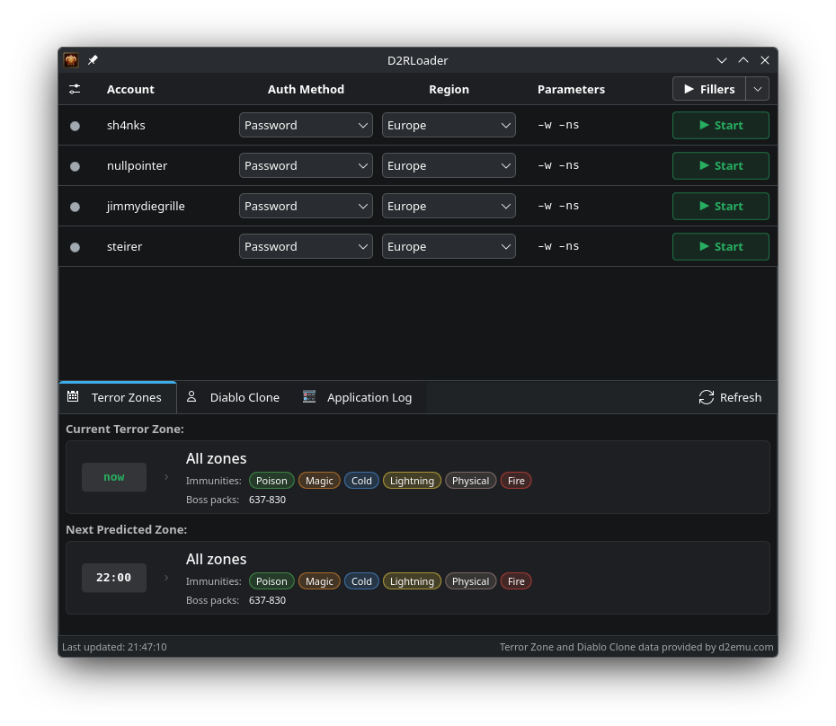

# D2RLoader 2

Note: This repo will eventually be merged into sh4nks/d2rloader.

<p align="center">
  
</p>

## Getting Started

D2RLoader supports Windows and Linux (via Wine/[UMU-Launcher](https://github.com/Open-Wine-Components/umu-launcher)).

I have only tested my Linux environment (Arch Linux) so far. So, if you find any issues with yours, please report them so I can get them fixed!

The TZ Info and DClone Info require a working API key from [d2emu.com](https://d2emu.com).

Game and Account related things are stored in ``$XDG_CONFIG_DIRS/d2rloader/``.
Application specific settings are stored in ``$XDG_CONFIG_DIRS/d2rloaderrc``.

On Windows it should be ``%APPDATA%\d2rloader``.


### Upgrading from the previous D2RLoader

The first start imports the configuration of the [previous D2RLoader](https://github.com/sh4nks/d2rloader)
when its ``settings.json`` is found in ``%APPDATA%\d2rloader`` on Windows or ``~/.config/d2rloader`` on Linux.
The old account settings are renamed to accounts.json.bak.


## Installation

All downloads are on the [release page](https://github.com/sh4nks/d2rloader2/releases).
To build the app yourself see [BUILD.md](BUILD.md).


### Linux

Pick one of the following.

#### AppImage

Needs [UMU-Launcher](https://github.com/Open-Wine-Components/umu-launcher) (``umu-run``) to be installed.

```bash
$ chmod +x D2RLoader-<version>-x86_64.AppImage
$ ./D2RLoader-<version>-x86_64.AppImage
```

#### Flatpak

UMU-Launcher is bundled.

```bash
$ flatpak install --user D2RLoader-<version>-x86_64.flatpak
$ flatpak run com.someblocks.d2rloader
```

#### Arch Linux

Build and install the package with the provided PKGBUILD:

```bash
$ cd packaging/arch/d2rloader
$ makepkg -si
```

Afterwards:

- Install D2R from your favorite Game Launcher (Lutris/Bottles, etc)
- Add a profile with one of the configured auth methods below.
- Have fun!


### Windows

- Download the installer (``D2RLoader-<version>-windows-x86_64-setup.exe``) or the portable zip
  (``D2RLoader-<version>-windows-x86_64.zip``).
    - The installer puts D2RLoader into ``%LOCALAPPDATA%\Programs`` for the current user and needs no
      administrator rights. The zip runs from wherever it is extracted. Both keep their settings in ``%LOCALAPPDATA%``.
    - Neither is code signed, so SmartScreen warns on the first start: choose _More info_ -> _Run anyway_.
- Install D2R through the Battle.net app and set its directory in the application settings.
- Add a profile with one of the configured auth methods below.
- Have fun!


## Auth Methods

You can choose between 2 auth methods. However, the token authentication is more robust and allows one to use MFA.


### Password

Deactivate your Battle.net Authenticator for your account because passing passwords via parameters won't work with Multi-Factor Authentication (MFA).

If you try to login using password authentication and get an error like  _"We couldn't verify your account with that information"_, try changing your password and try again. This worked for me at least.


### Token

This method works with Multi-Factor Authentication!

1. Open a browser in private mode
2. Navigate to https://us.battle.net/login/en/?externalChallenge=login&app=OSI
3. Log in to your account
4. You will be redirected to an unknown (localhost) page.

    For Chrome-based browsers:

    - Your URL will look something like this:
    http://localhost:0/?ST=US-c099c810-2b2c-42b6-8bd0-ae6735d54510&flowTrackingId=37f670de-7831-4b32-9cb5-2a219e9eea4a

    - Copy the whole URL and paste it in your Account settings. D2RLoader takes the token
      (i.e. ``US-c099c810-2b2c-42b6-8bd0-ae6735d54510``) out of it.

    For Firefox you have to open the console (F12) and go to _Storage_ -> _Cookies_ and copy the **value** from the ``gs.id`` cookie


## Command Line

Accounts and launch sequences can be started from CLI as well (or via a desktop shortcut that calls this CLI):

```bash
$ d2rloader --launch "My Sorc" --launch Barb   # start these accounts, in this order
$ d2rloader --sequence "MF Team"               # start the accounts of a launch sequence
$ d2rloader --minimized --sequence "MF Team"   # the same but minimized
```

- Names are matched without regard to case. Several accounts are started one after another with the
  delay of the launch sequence settings, and accounts that are running already are skipped.
- ``--minimized`` hides the window in the system tray when _Close to System Tray_ is enabled, and minimizes it otherwise.
- When D2RLoader is running already, ``--launch`` and ``--sequence`` are passed on to it and no second window opens.
  The accounts are started after those of a launch sequence that is still running.


## Disclaimer

I used LLMs to develop this. If you are looking for an organic version use the
old [d2rloader](https://github.com/sh4nks/d2rloader).

## Credits

The TZ Info and DClone Info is fetched from [d2emu.com](https://d2emu.com).

The application icon is adapted from ["Diablo skull"](https://game-icons.net/1x1/lorc/diablo-skull.html) by [Lorc](https://lorcblog.blogspot.com), licensed under [CC BY 3.0](https://creativecommons.org/licenses/by/3.0/).

Diablo is a trademark of Blizzard Entertainment, Inc. This project is not affiliated with or endorsed by Blizzard Entertainment.


## License

MIT License
